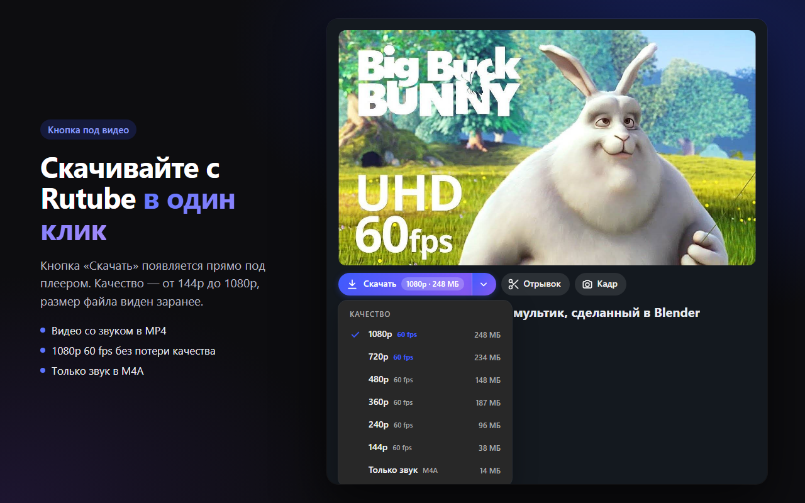
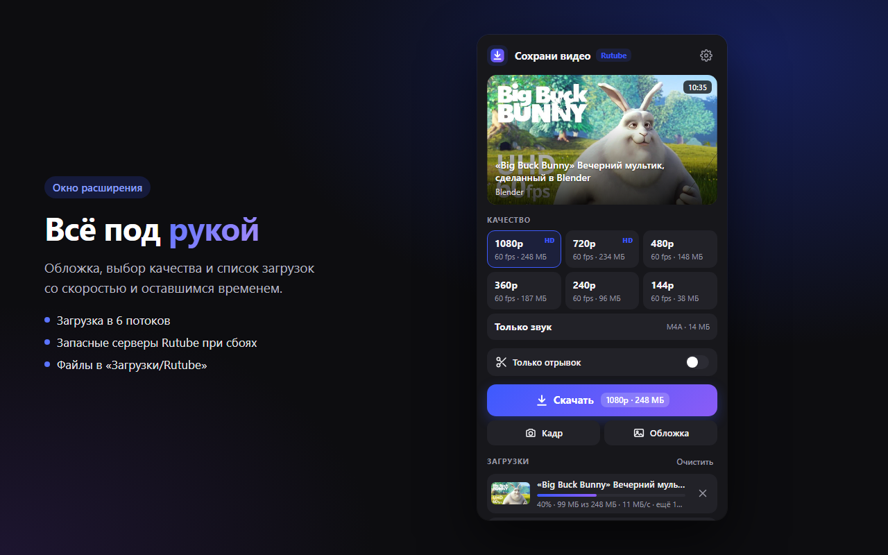
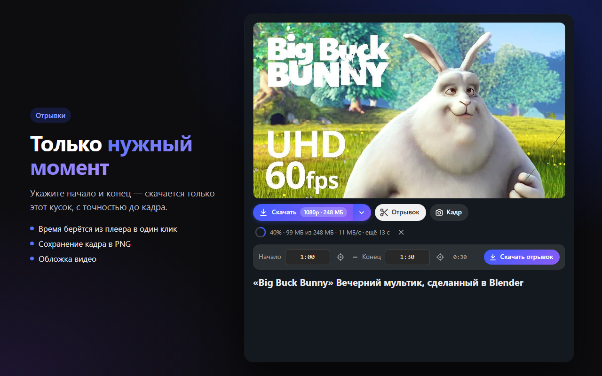

<p align="center">
  
</p>

<h1 align="center">Сохрани видео для Rutube</h1>

<p align="center">
  Расширение для Firefox: скачивание видео с Rutube со звуком —<br>
  прямо в браузере, без сторонних программ.
</p>

<p align="center">
  <a href="https://addons.mozilla.org/ru/firefox/addon/save-video-rutube/"><b>Установить из каталога Firefox →</b></a>
</p>

<p align="center">
  
</p>

## Возможности

- **Кнопка «Скачать» под каждым видео.** Меню качества — 1080p … 144p или только звук, размер файла виден заранее.
- **Окно на панели браузера.** Обложка, название, выбор качества и список загрузок с прогрессом, скоростью и оставшимся временем.
- **Отрывок.** Укажите начало и конец — скачается только этот кусок, с точностью до кадра. Загружаются только нужные сегменты, поэтому это быстро даже для длинных видео.
- **Кадр.** Текущий кадр сохраняется в PNG в полном разрешении.
- **Обложка.** Превью видео в один клик.
- **Быстро и надёжно.** Загрузка в 6 потоков. Если один из серверов Rutube не отвечает, расширение само переключается на запасной.
- **Без потери качества.** Видео и звук сохраняются в обычный MP4 (H.264 + AAC) без перекодирования. Только звук — M4A.
- **Без лишнего.** Не нужно ставить программы, не собираются никакие данные, расширение обращается только к серверам Rutube.

Файлы сохраняются в папку «Загрузки/Rutube». В настройках окна можно включить «Спрашивать, куда сохранить файл».

## Скриншоты

| Окно расширения | Отрывок |
|---|---|
|  |  |

## Установка

**Из каталога Firefox** (рекомендуется): [addons.mozilla.org](https://addons.mozilla.org/ru/firefox/addon/save-video-rutube/) → «Добавить в Firefox».

**Из исходников** (для разработки):
1. Скачайте репозиторий.
2. Откройте `about:debugging#/runtime/this-firefox`.
3. Нажмите «Загрузить временное дополнение…» и выберите `extension/manifest.json`.

Временное дополнение работает до перезапуска Firefox.

## Как это работает

Всё происходит внутри расширения, без сервера и без внешних программ.

1. **Список качеств.** [`lib/rutube.js`](extension/lib/rutube.js) берёт данные о видео из API плеера Rutube (`/api/play/options/<id>/`) и читает HLS-плейлист: какие есть качества, на каких серверах и из каких сегментов состоит видео.
2. **Загрузка.** [`background.js`](extension/background.js) скачивает сегменты MPEG-TS выбранного качества в 6 потоков. Для отрывка берутся только сегменты, попадающие в нужный интервал. При сбое сегмент перезапрашивается с запасного сервера.
3. **Разбор потока.** [`lib/ts.js`](extension/lib/ts.js) — разборщик MPEG-TS на чистом JavaScript. Он достаёт из сегментов кадры H.264 и звук AAC вместе с метками времени.
4. **Сборка MP4.** [`lib/mp4.js`](extension/lib/mp4.js) собирает из них обычный MP4 с синхронными дорожками, без перекодирования. Лишние кадры перед началом отрывка скрываются списком правок (`edts`), поэтому отрывок начинается ровно с указанного момента.
5. **Сохранение.** Готовый файл отдаётся браузеру через API загрузок.

### Структура

```
extension/
├── manifest.json
├── background.js        загрузка, очередь, сохранение файлов
├── content.js/.css      панель с кнопками под видео
├── popup.html/.css/.js  окно расширения
├── common.js            общие функции и иконки
├── lib/
│   ├── rutube.js        данные о видео и плейлисты HLS
│   ├── ts.js            разбор MPEG-TS (H.264 + AAC)
│   └── mp4.js           сборка MP4
└── icons/icon.svg
```

## Сборка

Нужен Node.js.

```bash
npx web-ext lint -s extension
```

```bash
npx web-ext build -s extension -a dist
```

Готовый архив появится в папке `dist/`.

## Ограничения

Платные видео, видео с защитой от копирования (DRM) и прямые трансляции не поддерживаются.

## Если перестало качать

Rutube может изменить API плеера или формат плейлистов. Запросы к Rutube собраны в [`lib/rutube.js`](extension/lib/rutube.js). Сообщения о проблемах — в [Issues](../../issues).

## Отказ от ответственности

Расширение предназначено для сохранения видео, на которые у вас есть права: собственных роликов, видео под свободными лицензиями и т. п. Соблюдайте авторские права и правила Rutube. Проект не связан с Rutube.

На скриншотах — кадры из мультфильма [Big Buck Bunny](https://peach.blender.org/) © Blender Foundation, лицензия CC BY 3.0.

## Другие расширения

[Сохрани видео](https://github.com/OlegChe77/save-video-firefox) — такое же расширение для YouTube.

## Лицензия

[MIT](LICENSE)
